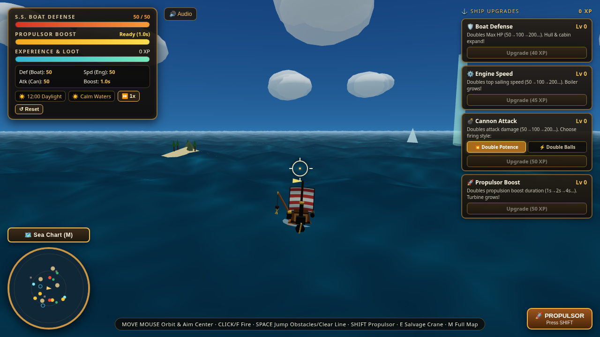
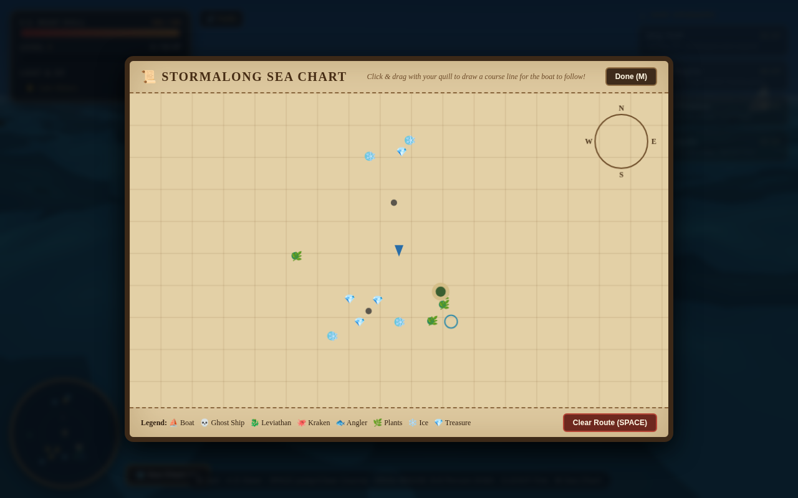

# 🌊 Boat Adventure

A single-file, browser-based 3D naval adventure built with **Three.js**. Sail a steam-powered boat across a stylized, cel-shaded ocean inspired by *The Legend of Zelda: The Wind Waker* and *Zelda: Phantom Hourglass*. Battle phantom ships, dodge icebergs and whirlpools, haul sunken treasure from the deep, and upgrade your vessel into an ironclad juggernaut — all while the sun sets, storms roll in, and leviathans rise from the deep.

Just open `index.html` in a modern browser and set sail. No build step, no dependencies beyond an internet connection for the Three.js CDN.





---

## ✨ Features

- **Cel-shaded toon ocean** with animated Gerstner-style waves, foam, and stylized specular highlights
- **Full day/night cycle** with orbiting sun & moon, stars, sunset tinting, and 1x / 4x / 16x timelapse speeds; the time badge tracks your **day count**
- **🌕🩸 Moon Blood** — every 28th day the moon turns red as blood and *every* enemy on the sea turns hostile at once. Safe harbors offer no shelter — run.
- **Sky easter egg** — aim the reticle at the sun and fire: it shatters into a storm of glowing shards and night falls. Shoot the moon instead and daylight breaks out. The broken body mends itself after a minute (or immediately when you shoot the other one)
- **Dynamic weather ladder**: Calm Waters → Stormalong Fog → Squall & Rain → GREAT STORM → Frozen Polar Sea, with lightning flashes, wind drift, and rain
- **Center-reticle aiming** — orbit the camera and fire cannons exactly where the crosshair points (third-person over-the-shoulder)
- **Two cannon styles**: 💥 *Double Potence* (1 mega shell) or ⚡ *Double Balls* (2 twin shells, half damage each)
- **7 enemy types** with floating health bars — now with fully redesigned, more realistic models: serpents with jaws & dorsal spines, an anglerfish with glowing lure and ragged teeth, and a kraken with sucker-studded arms. Pirate crews stand on the decks of the raiders, ghosts, and dreadnoughts; **phantom galleons sail ten times larger** than before. The sea also runs **three times as many enemy boats** as it used to.
- **Randomized kill verbs** — enemies get `SUNK`, `YEETED`, `BANISHED`, `SENT TO DAVY JONES`, `REKT`, `UNSUBSCRIBED`, `COMPOSTED`, `TENDERIZED`, `GENTLY ESCORTED TO THE ABYSS`, or `CONVERTED TO CORAL` when they go down (with ⚔️MIGHTY / ⚡COLOSSAL tier tags), and they **taunt you** between cannonades.
- **Environmental hazards**: rocks, lily-pad plants, icebergs & ice floes, tropical islands, and whirlpools (which drag you in and damage your hull)
- **🛟 Safe Harbors** — glowing green sanctuary beacons. Anchor inside one (press **E**) to hold position against wind and current, and enemies refuse to engage you. Note: Moon Blood renders them useless.
- **Deep-sea treasure beacons** — columns of light mark sunken chests; drop the salvage crane to haul up loot from randomized rarity tables rich in wet socks, haunted cutlery, and slightly dented crowns
- **Sea Chart autopilot** — draw a route on the parchment map and the boat follows it
- **Live mini-map** with hazards, enemies, treasure, and route overlay
- **Ship growth** — hull, boiler, turbine, and cannons visually scale as you upgrade
- **Procedural audio** synthesized via Web Audio API (cannons, splashes, treasure chimes, boost, crane)
- **Pause menu** (**ESC**) with Peaceful / Easy / Medium / Hard / Impossible difficulty presets, Sound & SFX toggles, and Save & Exit
- **Auto-save** to `localStorage` every 5 seconds (plus manual Reset)

---

## 📜 Legend

| Icon | Meaning |
|---|---|
| ⛵ | Player Boat / Disgruntled Pirate Raider |
| 💀 | Phantom Galleon (Fully Refunded) |
| 🐉 | Giant Sea Serpent (Emotional Support) |
| 🐙 | Dread Kraken, Lord of Eight Regrets |
| 🐟 | Abyssal Gulper (Very Hungry) |
| 🦅 | Sky Drake With Something To Prove |
| 🏴‍☠️ | Titan Dreadnought, Esq. |
| 🌿 | Plants |
| ❄️ | Ice |
| 💎 | Deep Light (treasure) |
| 🛟 | Safe Harbor (enemies won't strike you here) |

---

## 🎮 Controls

| Input | Action |
|---|---|
| **Mouse move** | Orbit camera / aim center reticle (pointer-lock or click-drag; the camera stays above the waterline) |
| **Left Click** or **F** | Fire cannons |
| **W / S** or **↑ / ↓** | Throttle forward / reverse |
| **A / D** or **← / →** | Steer |
| **SPACE** | Jump over obstacles / clear charted route |
| **SHIFT** | Activate Propulsor Boost |
| **Right Click** or **E** | Drop salvage crane (near a treasure beacon) — or **anchor / weigh anchor** inside a Safe Harbor |
| **M** | Open / close full Sea Chart |
| **Mouse Wheel** | Zoom camera in/out |
| **ESC** | Pause / Resume (opens the settings & difficulty menu) |

---

## ⚓ Ship Upgrades

Earn **XP** from sinking enemies, collecting XP orbs, and salvaging treasure. Spend it in the top-right panel. Every upgrade adds **+1** to its stat, and the ship model visibly grows.

| Upgrade | Base Stat | Cost (Lv 0) | Effect |
|---|---|---|---|
| 🛡️ **Boat Defense** | 10 HP | 40 XP | +1 Max HP per level (10 → 11 → 12 → …) |
| ⚙️ **Engine Speed** | 10 | 45 XP | +1 top sailing speed per level |
| 💣 **Cannon Attack** | 10 | 50 XP | +1 attack damage per level |
| 🚀 **Propulsor Boost** | 10 s | 50 XP | +1 s boost duration per level |

Enemies are tuned to a similar scale: raiders are weak, while Krakens, Serpents and Titan Dreadnoughts are tough — and larger foes have more HP.

Costs scale by `base × 2.1^tier`, so plan your spending.

---

## 🗺️ The Sea Chart

Press **M** or click the map button to open the full **parchment Sea Chart**:

- **Click & drag** on the chart with your "quill" to draw a route for the boat to follow automatically.
- A glowing autopilot badge appears while a route is active — press **SPACE** to clear it.
- The chart shows boats, enemies (each with its own icon), hazards, treasure beacons, and a compass rose.

---

## 🌦️ World Systems

- **Time** advances continuously; the badge in the top-left shows the hour, phase (Dawn / Daylight / Dusk / Night), and the current **Day**. Every 28th day the **Moon Blood** rises: the moon bleeds red and every ship on the sea turns hostile at once.
- **Weather** cycles on its own timer, or you can force progression by watching the banner. The skies now have a personality: *Suspiciously Calm Waters*, *Fog You Can Taste*, *Squall & Rain & Mild Regret*, *THE GREAT STORM (Please Stop)*, and *Frozen Polar Sea (Bring a Coat)*. Great Storms summon lightning and heavy seas; the Frozen Polar Sea spawns ice hazards.
- **Wind** drifts clouds and pushes your boat, growing stronger in storms — unless you've dropped anchor in a Safe Harbor, which holds you dead still.
- **Safe Harbors** bounce around the map as green beacons; inside one, enemies keep their distance and incoming enemy shot harmlessly ricochets away. Press **E** to anchor and stay exactly put — a safe place is only safe on ordinary nights, so don't trust it when the moon turns red.

---

## 💾 Saving & Reset

- Progress (XP bank, kills, treasures, upgrade tiers, cannon style, current HP) auto-saves to your browser's `localStorage`.
- Use the **↺ Reset** button in the stats panel to wipe your save and start fresh.

---

## 🛠️ Tech Notes

- **Single HTML file** — all CSS, JavaScript, and game logic inline.
- **Three.js r160** loaded via import map from unpkg CDN.
- Shaders written as inline GLSL for the sky dome and ocean surface.
- Game objects (projectiles, particles, wake rings, smoke puffs, flashes) use **object pooling** to avoid garbage collection hitches.
- A `window.game` object exposes `player`, `hazards`, `treasures`, `enemies`, `havens`, `celestial`, `bloodMoon`, and key functions (`fireCannons`, `triggerSalvage`, `triggerBoost`, `buyUpgrade`, `setDifficulty`, `togglePause`, …) for debugging in the console.

---

## 🚀 Getting Started

```bash
# Clone or download, then simply open the file:
open index.html      # macOS
start index.html     # Windows
xdg-open index.html  # Linux
```

Or serve locally:

```bash
python3 -m http.server 8000
# then visit http://localhost:8000
```

> **Requires** a modern browser with WebGL and pointer-lock support (Chrome, Edge, Firefox, Safari).

---

*Set your course, hoist the sail, and may the storms spare your hull.* ⚓🌩️